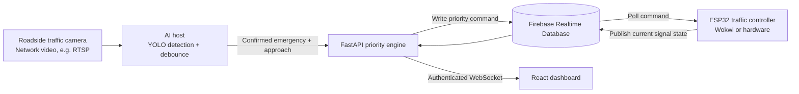

# Smart Intersection Digital Twin

An IoT and computer-vision prototype for giving emergency vehicles safe priority at a four-approach intersection. The project combines an ESP32 traffic-signal controller, a FastAPI priority service, a Firebase command mailbox, an optional vision worker, and a live web dashboard.

> **Project status:** the replay-based demo and Wokwi ESP32 controller are implemented. The roadside-camera deployment path is designed, but no real traffic camera is connected in the current demo. Live YOLO inference requires a compatible video source and trained model weights, which are not included in this repository.

## At a glance

- **Intersection:** North, East, South, and West approaches, each represented by red, yellow, and green LEDs in Wokwi.
- **Controller:** ESP32 DevKit V1 runs a local finite-state machine (FSM), handles priority commands, and drives the traffic lights, status LED, and buzzer.
- **AI pipeline:** a host-side Python vision worker can run YOLO on camera/video frames, debounce detections, and submit confirmed emergency detections to FastAPI.
- **Priority logic:** the server translates a confirmed approach into a sequenced command. The ESP32 completes the configured safety clearance before granting priority.
- **Digital twin:** a React dashboard shows the signal state, live data flow, health, events, and a fixed-time-versus-priority simulation comparison.
- **Demo options:** deterministic replay with an in-process mock controller, or a connected Wokwi ESP32 using Firebase Realtime Database.

## Camera-to-signal architecture

In a deployment, an existing roadside or highway camera provides a network video stream to an edge computer or server running the vision worker. The camera does not connect to the ESP32 GPIO pins, and the ESP32 does not run YOLO. It receives an approach-specific command through Firebase and independently enforces the signal timing and safety rules.



The **AI host** and the **signal controller** have separate responsibilities: the AI host identifies and confirms a possible emergency vehicle, while the ESP32 controls the lights locally. This keeps signal timing independent of video-processing delays.

### What is implemented and what is planned

| Capability | Status |
|---|---|
| Four-way traffic-light FSM in ESP32 firmware | Implemented and buildable |
| Wokwi ESP32 simulation with LEDs, status LED, and buzzer | Implemented |
| Firebase REST command and state exchange | Implemented; depends on Firebase connectivity and configuration |
| API, priority engine, and dashboard live-state feed | Implemented |
| Deterministic emergency-detection replay | Implemented; works without a model or camera |
| Trained YOLO11n model | A 4-class `best.pt` checkpoint is present in this workspace but excluded from Git |
| YOLO inference from supplied video | Tested on local clips; inference evidence and checkpoint-reported metrics are documented in [AI model evaluation](docs/AI_MODEL_EVALUATION.md) |
| Connection to installed roadside/highway cameras | Planned deployment integration; not connected in the current demo |
| ESP32 verification of HMAC command signatures | Not implemented; firmware validates command sequence and fields, not HMAC signatures |

## How an emergency request works

1. The vision worker evaluates frames and applies confidence, bounding-box, and temporal debounce checks.
2. A confirmed emergency detection is submitted to `POST /api/v1/detections` with its approach (N, E, S, or W).
3. The priority engine publishes a sequenced `PRIORITY` command to Firebase.
4. The ESP32 polls Firebase, validates the command, and runs the local safety FSM.
5. The controller publishes its current phase and lights. The dashboard receives that state through the API WebSocket.
6. When the detection stream clears, the priority engine issues a safe release and the controller resumes its normal cycle.

For an emergency request across the other axis, the controller observes the configured minimum green and then completes yellow and all-red clearance before granting the requested approach. During priority green, only the requested approach is green; the other three approaches remain red.

## Technology

| Layer | Main components |
|---|---|
| Embedded controller | ESP32 DevKit V1, Arduino C++, Wokwi |
| Signal logic | Local finite-state machine, `millis()` timing, watchdog/fallback behavior |
| Cloud mailbox | Firebase Realtime Database REST API |
| API and orchestration | Python, FastAPI, Pydantic, JWT authentication |
| Computer vision | Python vision worker, OpenCV, Ultralytics YOLO, temporal debounce |
| Dashboard | React, TypeScript, Vite, WebSocket |
| Persistence and experiments | MongoDB or in-memory development clients; deterministic A/B simulator |

## Safety behavior and timings

The firmware controls the local light sequence even when cloud or network requests are delayed. The configured profile in [`config.yaml`](config.yaml) and the matching firmware constants are:

| Setting | Value |
|---|---:|
| Normal green | 10 s |
| Normal yellow | 3 s |
| Normal all-red clearance | 2 s |
| Minimum green before preemption | 5 s |
| Emergency yellow clearance | 2 s |
| Emergency all-red clearance | 1 s |
| Priority hold watchdog | 30 s maximum |
| Heartbeat-loss fallback threshold | 10 s |

Emergency clearance is 3 seconds **after the minimum-green condition permits the transition to begin**. It is not a guarantee that every request will be granted within 3 seconds of detection.

The design enforces these safety goals:

- North-South and East-West traffic are never green simultaneously.
- Conflicting movements pass through yellow and all-red clearance.
- A priority request does not cut a green phase before minimum green.
- Commands with invalid approaches or non-increasing sequence numbers are rejected by the firmware.
- A priority hold is bounded, and loss of controller heartbeat leads to fallback behavior.

## Quick start: replay demo

The replay demo is the fastest reproducible way to try the project. It uses sample detections, an in-memory Firebase substitute, and an in-process mock ESP32. It does not need a camera, Firebase account, MongoDB service, or YOLO weights.

### Requirements

- Python 3.11 or 3.12
- Node.js 18 or newer and npm
- A modern browser

### Install

From the repository root:

```bash
python -m venv .venv
```

Activate the environment and install the API requirements:

```powershell
# Windows PowerShell
.\.venv\Scripts\Activate.ps1
```

```bash
# macOS / Linux
source .venv/bin/activate
```

```bash
python -m pip install -r server/requirements.txt
cd web
npm install
cd ..
```

### Run

Start the offline API in Terminal 1:

```bash
python scripts/run_demo.py
```

Start the dashboard in Terminal 2:

```bash
cd web
npm run dev
```

Open [http://localhost:5173](http://localhost:5173). To replay the sample emergency detections, use Terminal 3:

```bash
python vision/worker.py --mode replay
```

Watch the replay log for unconfirmed frames followed by confirmed ambulance detections. A confirmed detection requests priority; the mock controller then reports the light-state changes to the dashboard. The replay is a deterministic demonstration of the detection-to-command pipeline, not live camera inference.

The demo launcher forces in-memory Firebase, MongoDB, and mock ESP32 modes for its own process. It leaves your `.env` file unchanged.

## Run the trained AI model on video

This is separate from the quick replay demo above: it loads the actual YOLO11n weights and runs inference on video frames. Install the vision dependencies, then run:

```bash
python -m pip install -r vision/requirements.txt
python vision/evaluate_model.py --sample-count 8 --save-images 2
```

The evaluator samples local videos under `data/videos/` and creates `runs/ai_model_evaluation/summary.json`, `predictions.csv`, and annotated frame images. These show model class predictions, confidence scores, and bounding boxes. The report also fingerprints the weights file so the run can be tied to the checkpoint. The videos do not have frame-level ground truth in this repository, so this is a real inference demonstration, not an accuracy benchmark. For checkpoint metrics and a bounded end-to-end detection-to-mock-controller run, see [docs/AI_MODEL_EVALUATION.md](docs/AI_MODEL_EVALUATION.md).

## Run with Wokwi and Firebase

This option connects the simulated ESP32 to the API through Firebase Realtime Database. It does not add a roadside camera; use dashboard manual dispatch or the replay worker to create a priority request.

1. Configure a Firebase Realtime Database and set `FIREBASE_MODE=rest`, `ESP32_MODE=wokwi`, and `MONGO_MODE=memory` in your local `.env`.
2. Set the matching Firebase database URL and any required authentication locally for the firmware and API. Do not commit Firebase secrets or paste them into public project files. Confirm that the database rules allow only the required authenticated access.
3. Build the current ESP32 firmware from the repository root:

   ```bash
   platformio run -d firmware
   ```

4. Open your Wokwi ESP32 project and use [`firmware/sketch.ino`](firmware/sketch.ino) and [`firmware/diagram.json`](firmware/diagram.json). Install the library listed in [`firmware/libraries.txt`](firmware/libraries.txt). If you use the Wokwi extension/CLI workflow, configure it with [`wokwi.toml`](wokwi.toml).
5. Start the API using the live-mode `.env` settings:

   ```bash
   uvicorn server.app.main:app --reload --host 0.0.0.0 --port 8000
   ```

6. Start the web dashboard as shown above, then start or restart Wokwi with the current firmware.
7. Confirm that the API reports fresh state with `controller_id: "wokwi"` and that `uptime_ms` and `phase` advance. A successful page load by itself does not prove the controller is connected.

> **Credential note:** the repository includes development-only demo accounts and secrets for local use. Replace them before exposing any service to a network. Do not use the demo credentials, development JWT secret, or an open Firebase database for deployment.

## Connect a real traffic camera (deployment path)

The vision worker accepts a webcam index or video source through OpenCV. For live deployment, run it on a host that can reach both the camera stream and the API. Install the vision dependencies:

```bash
python -m pip install -r vision/requirements.txt
```

Place compatible trained weights at the configured path (`vision/weights/best.pt` by default); model weights are not distributed in this repository. Then provide the camera stream URL and the approach monitored by that camera:

```bash
python vision/worker.py --mode live --video "rtsp://CAMERA_HOST/STREAM_PATH" --approach N
```

Replace the example URL and approach for the installation. Use `N`, `E`, `S`, or `W`. Securely manage any camera credentials and network access on the AI host. Do not embed camera usernames/passwords in this README, source control, or a public command history.

In this setup, video travels from the camera to the AI host. Only a confirmed detection and its approach are sent to FastAPI; Firebase carries the resulting priority command to the ESP32. The ESP32 remains responsible for the local signal sequence and does not process video.

## Dashboard pages

- **2D Digital Twin:** live or mocked phase, signal states, vehicle animation, and operator priority controls.
- **Architecture:** service health plus the clearly marked planned roadside-camera → AI host → priority engine → Firebase → ESP32 deployment path.
- **A/B Battle Compare:** deterministic comparison of fixed-time and priority-control scenarios. Treat displayed values as simulator results for the selected run, not field measurements.
- **Priority Events:** recorded priority requests and outcomes from the configured data store.
- **Security Audit:** authentication and rate-limit events available from the configured data store.
- **System Health:** API and dependency status.

## Configuration

| File | Purpose |
|---|---|
| [`.env.example`](.env.example) | Local API modes, ports, Firebase/Mongo connection settings, and development security settings |
| [`config.yaml`](config.yaml) | Intersection ID, signal timings, detection thresholds, and simulator parameters |
| [`firmware/sketch.ino`](firmware/sketch.ino) | ESP32 signal FSM, Firebase mailbox client, and asynchronous state reporting |
| [`firmware/diagram.json`](firmware/diagram.json) | Wokwi ESP32 and signal-light circuit |
| [`vision/worker.py`](vision/worker.py) | Live video inference and detection submission |
| [`data/replay/demo_ambulance_north.json`](data/replay/demo_ambulance_north.json) | Sample deterministic detection trace |

Useful local endpoints:

| Endpoint | Purpose |
|---|---|
| `http://localhost:8000/api/v1/health` | API, Firebase, Mongo, and controller health summary |
| `http://localhost:8000/docs` | Interactive API documentation |
| `GET /api/v1/intersections/i1/state` | Current controller state (operator/admin authentication required) |
| `POST /api/v1/intersections/i1/command` | Manual `PRIORITY` or `CLEAR` command (operator/admin) |
| `POST /api/v1/detections` | Detection ingestion (camera/operator/admin role) |
| `WS /api/v1/ws/state?token=<JWT>` | Authenticated live state stream |
| `POST /api/v1/sim/run` | Run a deterministic baseline/priority comparison |

## Tests and build

Run the backend tests:

```bash
python -m pytest server/tests -v
```

Check and build the web app:

```bash
cd web
npm run lint
npm run test
npm run build
```

Build the Wokwi firmware from the repository root:

```bash
platformio run -d firmware
```

## Known limitations and next steps

- The standard demo replays prerecorded detections. Live YOLO requires compatible weights, host compute, and a reachable camera/video stream.
- No roadside or highway camera is connected in the current demonstration; the architecture page marks this integration as planned.
- Camera-to-approach mapping must be configured correctly for each deployed camera.
- Firebase, Wi-Fi, API, and video-stream delays can affect how quickly a remote request is observed. The controller FSM continues to enforce its local phase rules.
- The ESP32 firmware does not validate HMAC signatures. Do not treat the development authentication settings as production security.
- Simulator KPIs and configured latency targets are not measured field outcomes. Record repeatable tests on representative hardware and video before making performance claims.
- This is an academic prototype, not a certified traffic-signal controller. Any real-road deployment requires qualified engineering, safety review, secure infrastructure, and approval from the responsible road authority.

## Repository map

```text
firmware/    ESP32 firmware, Wokwi diagram, and build configuration
server/      FastAPI application, Firebase/Mongo clients, priority engine, tests
vision/      YOLO video worker, debounce filter, replay driver, training tools
web/         React + TypeScript dashboard
data/replay/ Deterministic sample detection trace
docs/        Architecture and demonstration notes
scripts/     Offline launcher and project demo utilities
```
